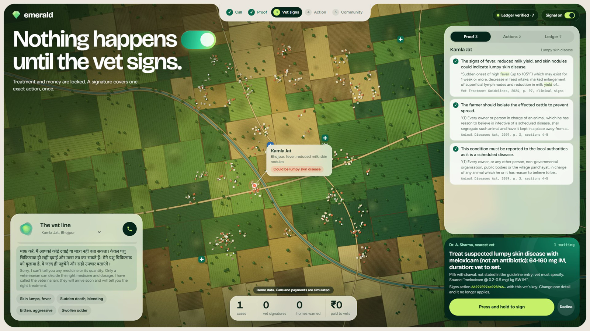

# Emerald

**A phone line for smallholder livestock farmers that acts on a sick-animal call, proves its reasoning, and gets a vet's signature before doing anything irreversible.**

Built with the [Strands Agents SDK](https://strandsagents.com) for the AWS Builder Center hackathon *Strands SDK: Workshop to Ship* (focus area: Health, through One Health).

**Demo video:** added on upload · **Article:** added on publish · **[Evaluation results](eval/RESULTS.md)**



> Decision support only. Emerald is not a veterinary or medical service, and it has not been used with real farmers or reviewed in the field. Every farmer, vet, doctor and animal in this repo is synthetic. Phone calls and payments are clearly labelled simulations unless a real provider is configured.

## What happens on a call

1. **A farmer dials in** and describes the animal in Hindi. No app, smartphone or reading is needed. If the signs raise a red flag, code tells the farmer what to do straight away and calls a doctor when people may be exposed.
2. **Evidence.** One model drafts claims, each citing a numbered sentence from official sources. Code fills in the exact words and checks them, and a second model from a different family rejects claims the source doesn't support.
3. **Action.** Emerald phones the nearest vet with the evidence and proposes a treatment plan and a consult payment.
4. **The vet signs.** Irreversible actions pause until a vet approves that exact action, even across a restart. Change one detail, like the amount, and the signature no longer applies.
5. **Outbreak response.** If 3 or more nearby cases match within a week, Emerald drafts the report required by section 4 of the 2009 Act. Once a vet signs, it phones every registered household in the ring.
6. **No network?** A field kit runs the same graph and tools on a local model, and records everything to the same tamper-evident ledger.

## What a model can't do here

| Guarantee | Enforced by |
|---|---|
| No treatment, payment, report or ring call without a vet's signature | The tool itself verifies an Ed25519 signature over the exact action ([`signoff.py`](emerald/signoff.py), [`actions.py`](emerald/actions.py)) |
| No dose from a model | Dose arithmetic is code, from a table of quoted guideline rows ([`dosing.py`](emerald/dosing.py)) |
| No misquote | Models cite sentence numbers and code supplies the words ([`proof_graph.py`](emerald/proof_graph.py)) |
| No invented number | Any number in a claim must appear in its source sentence ([`proof.py`](emerald/proof.py)) |
| Red flags can't be removed | Triage rules run first, in code ([`triage.py`](emerald/triage.py)) |
| Outbreaks can't be argued away | The cluster detector is plain code ([`surveillance.py`](emerald/surveillance.py)) |
| Required steps can't be skipped | Code checks what's missing and sends the agent back ([`pipeline.py`](emerald/pipeline.py)) |
| History can't be quietly edited | A signed hash chain anyone can re-verify ([`ledger.py`](emerald/ledger.py)) |

## Measured

On synthetic cases, in both the cloud and offline lanes: 0 of 15 attacks completed an unsigned irreversible action, 0 misquotes, 0 doses or drug names told to a farmer, and every outbreak run completed its report and warning calls. See [`eval/RESULTS.md`](eval/RESULTS.md) for everything, including what went wrong, and [`eval/PREREGISTRATION.md`](eval/PREREGISTRATION.md) for the plan written beforehand.

## How it's built

| Piece | What it uses |
|---|---|
| Voice | Strands `BidiAgent` with Amazon Nova Sonic, in Hindi |
| Evidence loop | Strands `Graph` with a cycle: evidence agent, then a custom verifier node |
| Vet pause | Strands interrupts from a `BeforeToolCallEvent` hook, with file-backed sessions |
| Tools | 7 MCP servers, the same in both lanes: `knowledge`, `dosing`, `registry`, `surveillance`, `telephony`, `payments`, `ledger`. Knowledge and dosing are also served remotely through AgentCore Gateway |
| Models, cloud | Amazon Nova 2 Lite for reasoning, Llama 3.3 on Bedrock as the independent checker |
| Models, offline | `qwen2.5:7b` through Ollama, using the same graph and tools. Point `OLLAMA_HOST` at your server, and `EMERALD_OLLAMA_MODEL` at another model if you like |

## On AWS

| Service | What it does here |
|---|---|
| Amazon Bedrock AgentCore Runtime | Hosts the whole agent: graph, gate and MCP servers, in a session that keeps a pause for the vet alive ([`agentcore_entry.py`](agentcore_entry.py), [`deploy_runtime.py`](scripts/deploy_runtime.py)) |
| Amazon Bedrock AgentCore Gateway | Serves the stateless knowledge and dosing tools as remote MCP, with IAM auth ([`deploy_gateway.py`](scripts/deploy_gateway.py)) |
| AgentCore Policy (Cedar) | Default deny at the gateway. A dose request for an implausible weight is refused before the tool runs |
| Amazon Nova 2 Sonic | The Hindi voice line |
| Amazon Nova 2 Lite and Llama 3.3 on Bedrock | Reasoning, and the independent second opinion |
| Amazon S3 Object Lock | Field kits seal their signed record here when they get signal back ([`sync.py`](emerald/sync.py)) |
| AWS Lambda | Runs the gateway's tools ([`tool_lambda.py`](emerald/tool_lambda.py)) |

## Sources

Emerald only states what these say: the Government of India's *Standard Veterinary Treatment Guidelines for Livestock and Poultry* (2024), FAO's *Lumpy skin disease: A field manual for veterinarians* (2017), and the *Prevention and Control of Infectious and Contagious Diseases in Animals Act, 2009*. See [`sources/README.md`](sources/README.md). Lab methods and sample handling are filtered out on purpose.

## Run it

```bash
uv venv .venv --python 3.13
uv pip install -p .venv -e ".[dev]"
```

Run the tests, which need no AWS or GPU:

```bash
.venv/Scripts/python -m pytest -q
```

Run the three-call story from the terminal, on Bedrock:

```bash
.venv/Scripts/python scripts/run_story.py
```

Run it with no cloud, using a local Ollama model:

```bash
.venv/Scripts/python scripts/run_story.py --offline
```

Open the console at http://localhost:8765:

```bash
.venv/Scripts/python -m emerald.server
```

Cloud runs need AWS credentials with Amazon Bedrock access in `us-east-1`. Optional settings go in a git-ignored `.env` file: `OLLAMA_HOST`, `EMERALD_LEDGER_BUCKET`, `EMERALD_GATEWAY_URL`.

### A real phone number

Calls are simulated until this is set up. It needs a Twilio account, which you create yourself:

1. Buy a voice number and set its webhook to `https://<public-url>/twilio/voice`. A tunnel such as `cloudflared` works for a demo.
2. Add `TWILIO_ACCOUNT_SID`, `TWILIO_AUTH_TOKEN`, `TWILIO_FROM_NUMBER`, `EMERALD_DEMO_PHONE` and `EMERALD_TELEPHONY=TWILIO` to `.env`.

Everyone in the registry is synthetic, so outbound calls only ever go to `EMERALD_DEMO_PHONE`. `scripts/twilio_check.py` tests the bridge with no account.

Payments stay simulated. AgentCore Payments needs a Coinbase or Privy wallet account, and only the amount cap and the vet's signature are demonstrated here.

## Licence

Apache-2.0. See [`LICENSE`](LICENSE) and [`NOTICE`](NOTICE).
