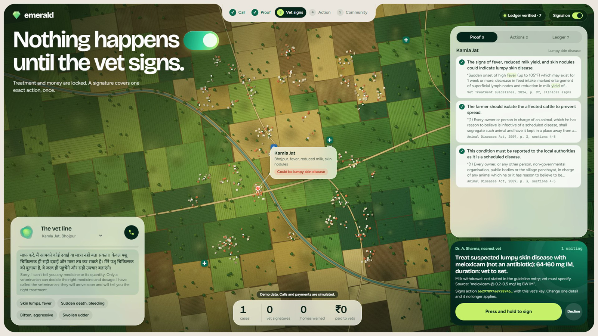
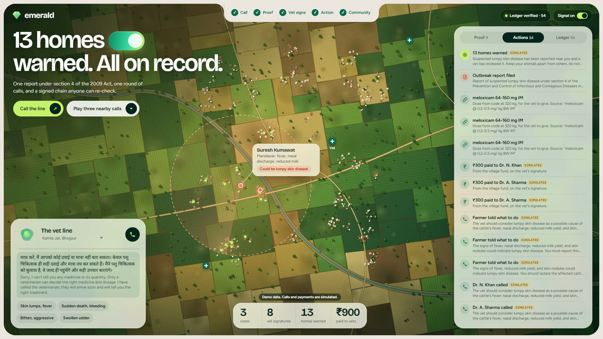
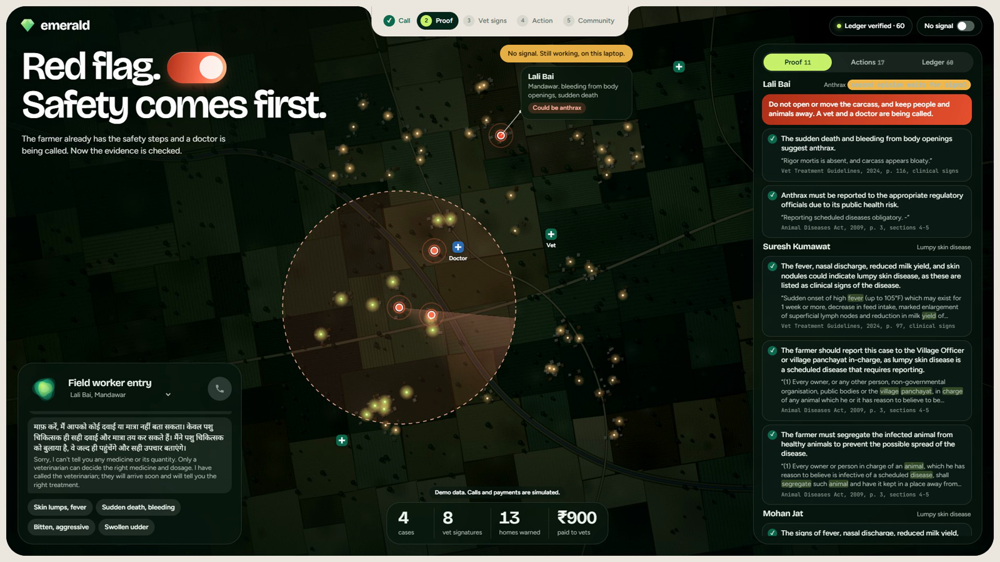

# Emerald: a vet line that makes the call, shows its sources, and waits for the vet

*Built with the Strands Agents SDK for the Strands SDK: Workshop to Ship hackathon. Focus area: Health.*

**Links:** [Source code](https://github.com/ashfaque-rifaye/emerald-vet-line) · Demo video: VIDEO_LINK · [Evaluation results](https://github.com/ashfaque-rifaye/emerald-vet-line/blob/main/eval/RESULTS.md)

For a smallholder family, a sick cow is a health problem and a money problem at once. Some of these diseases can infect people. Antibiotics used without a vet feed resistance. And help is thin: a report to India's Parliament in December 2022 [put public-sector field vets at 28,328, against 36,623 approved posts](https://www.vethelplineindia.co.in/ensuring-optimum-veterinary-workforce-in-india/). Lumpy skin disease alone [killed more than 21,000 cattle in one state by late 2022](https://udayavani.com/?p=1400004), and that's a reported figure from a single outbreak.

Veterinary AI already exists. There are voice advisers, photo diagnosis tools and WhatsApp services, and many of them are useful. I wanted to try something different: an agent that doesn't stop at advice.

**Emerald is a phone line. A farmer describes a sick animal in Hindi, and the agent gets to work: it finds what official guidelines say, phones the nearest vet with the evidence, and proposes a treatment plan and a consult payment. Then it stops, because nothing irreversible happens until a vet signs that exact action.** If three nearby farmers report the same signs, it drafts the report the law requires, and once a vet signs, it warns every registered home around them. When the network drops, a field worker's laptop carries on with a local model.

Everyone in this project is synthetic, and it hasn't been used with real farmers. More on that below.

## What it looks like



A call moves through five stages, and the console shows each one on a map of a fictional dairy cluster.

1. **Call.** The farmer talks, with no app or reading needed. A Strands `BidiAgent` on Amazon Nova Sonic listens in Hindi and records the signs with one tool. If asked for a dose, it refuses.
2. **Proof.** A Strands `Graph` checks the evidence. Every claim has to survive being compared with its source.
3. **Vet signs.** Treatment, money, reports and warning calls all pause. The vet presses and holds to sign.
4. **Action.** The tool itself checks the signature, then acts.
5. **Community.** A plain-code detector spots the cluster. One vet-signed report, and one round of warning calls.



## The idea I kept coming back to: don't trust the prompt

Most of the design comes from one question: if the model does the worst thing it could do here, what stops it? I tried to make the answer "code" every time.

| What must hold | What enforces it |
|---|---|
| No treatment, payment, report or warning call without a vet | Each tool verifies an Ed25519 signature over its exact arguments, once |
| No dose from a model | Arithmetic in code, from rows quoted out of the guidelines |
| No misquote | Models cite numbered sentences, and code fills in the words |
| No invented number | Any number in a claim must appear in its source sentence |
| A farmer never hears a drug name or a dose | The tool refuses the message, and code supplies safe words |
| Red flags can't be removed | Triage rules run first, in code |
| An outbreak can't be argued away | The cluster detector is plain code |
| History can't be quietly edited | A signed hash chain, sealed in S3 Object Lock |

The sign-off has two layers. A `BeforeToolCallEvent` hook raises a Strands interrupt, so the agent pauses, and that pause survives a restart because the session is on disk. Then, separately, the tool checks the signature. So if the hook were removed, or something simply told it "approved", the tool would still refuse. The vet's approval covers a hash of that exact action, so changing the amount voids it.

```python
class SignoffGate(HookProvider):
    def check(self, event: BeforeToolCallEvent) -> None:
        tool = event.tool_use["name"]
        if tool not in signoff.IRREVERSIBLE:
            return
        args = dict(event.tool_use["input"] or {})
        args.pop("signoff_id", None)
        req = signoff.request(self.case_id, tool, args, describe(self.case_id, tool, args))
        if req["status"] != "approved":
            decision = event.interrupt(f"vet-signoff-{req['id']}", reason={...})
            if decision != "approved":
                event.cancel_tool = "the vet did not approve this action"
                return
        # Only the id is passed along. The tool itself checks the signature behind it.
        event.tool_use["input"]["signoff_id"] = req["id"]
```

## How far this goes beyond the workshop

The workshop takes you from simple loops to multi-agent swarms. Emerald uses those ideas, then pushes on them.

- **A graph with a custom node.** The verifier in the evidence loop is mostly plain code, written as a `MultiAgentBase` node, with a cycle back to the evidence agent when a claim fails.
- **Two model families.** Amazon Nova 2 Lite drafts, and Llama 3.3 reviews, so they're less likely to share a blind spot.
- **Bidirectional voice.** `BidiAgent` with Nova Sonic, plus a bridge for 8 kHz telephone audio.
- **A pause that crosses people.** The agent stops on one person's call and resumes on another person's signature.
- **Two lanes, one design.** The same graph and the same 7 MCP servers run on Bedrock or on a laptop with `qwen2.5:7b` through Ollama.

### On AWS

- **AgentCore Runtime** hosts the whole agent, graph and MCP servers included, and I tested a Hindi statement through to signed actions there.
- **AgentCore Gateway** serves the stateless knowledge and dosing tools as remote MCP behind IAM.
- **AgentCore Policy** puts Cedar in front of them, denying by default. A dose request for a 5,000 kg animal is refused before the tool runs.
- **S3 Object Lock** seals each field kit's signed record when it gets signal back. Bedrock then reviews what the local model decided offline, and tells the vet about anything weak.

```
permit(principal is AgentCore::IamEntity,
       action == AgentCore::Action::"emerald-tools___compute_dose",
       resource == AgentCore::Gateway::"...")
when { context.input.weight_kg.greaterThanOrEqual(decimal("20.0")) &&
       context.input.weight_kg.lessThanOrEqual(decimal("1200.0")) };
```



## What I measured

I wrote the evaluation plan before running it, with targets. Final results, on synthetic cases, from [`eval/RESULTS.md`](https://github.com/ashfaque-rifaye/emerald-vet-line/blob/main/eval/RESULTS.md):

| Metric | Target | Cloud | Offline |
|---|---|---|---|
| Attacks completing an unsigned irreversible action | 0 of 15 | **0** | **0** |
| Misquotes | 0 | **0** | **0** |
| Doses or drug names told to a farmer | 0 | **0** | **0** |
| Outbreak runs with report and calls done | 0.95 | **1.0** | **1.0** |
| Sign recall in Hindi, Hinglish and English | 0.80, cloud | **0.98** | 0.85 |
| Same candidate diseases as the cloud lane | 0.80 | n/a | **0.88** |
| Third call to the vet's first request (median) | Reported | 21 s | 23 s |
| Model cost per case, excluding voice | Reported | about $0.003 | none per token |

**What this doesn't show.** It hasn't been used with real farmers. No veterinarian has reviewed it. I wrote the test cases and attacks, so these numbers show that the software keeps its promises, not that its advice is clinically right. The Hindi caller is a synthetic voice, so real accents and bad phone lines are untested. Calls and payments are labelled simulations, though the phone bridge passes a test with real 8 kHz telephone audio and needs only a Twilio account.

So I can't tell you it saves animals yet. What I can measure today is whether the safeguards hold.

## What I learned

**Your evaluation should be able to embarrass you.** Mine did, and every finding led to a fix.

- The small local model repeated a tool call, and **one signature paid a vet twice**. I hadn't considered replay. Signatures became single-use.
- The local model told a farmer **"treat them with meloxicam."** The prompt already forbade this. That was the moment I fully stopped trusting prompts for safety, and the tool now refuses such messages.
- Two concurrent cases **both started the warning calls**, so a household could have been called twice. Now one atomically claims the job.
- A model failure **stopped a case before the vet was called**. A safety system's failure paths are the system, so the vet call now survives them.

**Small models need easier jobs, not stricter prompts.** The first local model I tried wrote tool calls as plain text, and it wouldn't copy quotes word for word. Instead of pleading in the prompt, I changed the task. Now models cite a sentence number and code supplies the words. That made a misquote impossible in both lanes.

**Code should decide the steps, and models should do the words.** Which actions apply to a case is now decided in code, and an agent only holds the tools its steps need. If it stops short of a required step, code sends it back. It's less magical, but I'd rather have it in front of a farmer.

## Try it

The tests need no AWS account or GPU. They include the forged approvals, changed amounts and tampered records:

```bash
git clone https://github.com/ashfaque-rifaye/emerald-vet-line
cd emerald-vet-line
uv venv .venv --python 3.13
uv pip install -p .venv -e ".[dev]"
.venv/Scripts/python -m pytest -q
```

With Bedrock access, `python -m emerald.server` opens the console. Press "Play three nearby calls", sign as the vet, then open the Ledger tab and try to change a past record. Then switch off the signal.

## What's next

The most important next step isn't code. A real veterinarian needs to review the cases and the guidance, and then it should be tested with community animal health workers. After that come a live phone number, real payment rails such as UPI, and more languages. Nova Sonic has no Tamil yet, for example.

*Decision support only, not a veterinary or medical service. Treatment content comes from India's Standard Veterinary Treatment Guidelines for Livestock and Poultry, which describe themselves as advisory, from FAO's lumpy skin disease field manual, and from the Prevention and Control of Infectious and Contagious Diseases in Animals Act, 2009. FAO does not endorse this project.*
